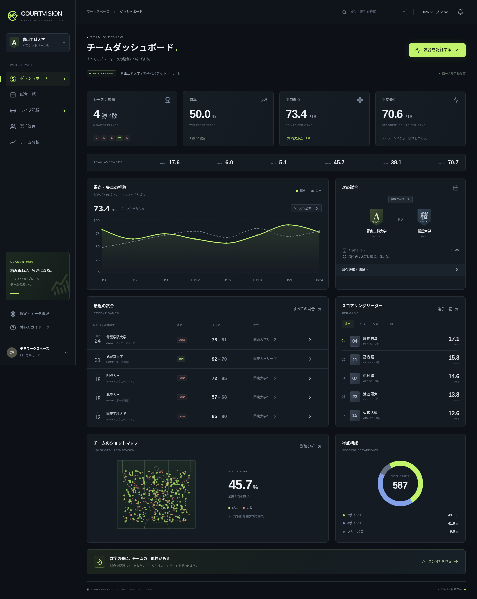

# COURTVISION

**すべてのプレーを、次の勝利につなげる。**

大学バスケットボール部向けの試合記録・チーム分析Webアプリです。スマートフォンでプレーを入力し、PCでシーズンやラインナップを分析できます。架空の「青山工科大学」を使って、アカウントなしですぐに操作できます。実際の部員データは含まれていません。



初めて公開する場合は、[Supabase・Vercel の作成から公開までの手順](docs/launch-guide.md)を順番に進めてください。

## 実行

Node.js 24 を使用します。

```bash
npm ci
npm run dev
```

ブラウザでポート3000を開いてください。本番モードは `npm run build` → `npm run start` です。Supabase の環境変数が未設定の場合はローカルモードになります。

## 主な機能

- ダークUI、PC・タブレット・スマートフォンのレスポンシブ表示
- 勝率、平均得失点、直近5試合、ランキング、得点推移、次の試合、得点構成
- 選手登録・写真アップロード・プロフィール編集・試合別成績・成績推移・ポジション絞り込み
- 試合登録、出場選手とスタメン5人の選択、大会・勝敗・状態・対戦相手での検索
- 2P/3P/FT、OREB/DREB、AST/STL/BLK/TOV/PF、相手の得点・成功失敗・各種スタッツのワンタップ入力
- 出場中の選手の強調、連続入力、Undo、履歴の訂正・削除、ショット位置修正
- 試合時計の開始・停止・修正、クォーター移行、5分の延長戦・最終Qからのチームファウル継続、途中からの記録開始
- 交代イベントから出場時間と選手・ラインナップのPlus/Minusを計算
- クォーター・前後半・シーズン集計、2〜5人の選手比較・レーダーチャート、対戦相手別成績、勝敗別分析、得点ランの可視化・時間帯別分析
- eFG%、TS%、AST/TO、推定得点効率。計算式と推定値の限界を画面に明記
- SVGショットマップ、選手・試合・シーズン・Q別の絞り込み、横3エリアの成功率
- CSV出力、印刷用シート、JSONバックアップと検証付き復元
- IndexedDBへのトランザクション付き自動保存、PWA、オフライン再読み込み・記録、旧localStorageからの移行
- Supabaseのマジックリンク認証、チーム作成、管理者・記録担当・閲覧者
- クラウド自動送信、閲覧時の10秒ポーリング、切断後の再送、revisionによる競合拒否

すべての表示値はプレーイベントから計算しています。デモの値も固定の成績を画面に埋め込んでいません。

## 試合を記録する

1. 設定から「空のチームで始める」を選び、チーム名・シーズンを設定します。初期化前のJSONも保存されます。
2. 選手管理から最低5人を登録します。
3. 試合登録で出場選手とスタメン5人を選びます。
4. 時計を開始し、出場中の選手を選んでプレーをタップします。ショット位置は先にコートをタップすると記録されます。
5. 交代・履歴訂正は時計を止めて操作します。ファウル5回はボックススコアで警告しますが、自動退場は行いません。
6. Q終了時は時計が00:00であることを確認して次のQへ進みます。試合終了後はシーズン成績に算入されます。

途中から始める場合は、最初の入力・時計開始より前に残り時間を修正してください。出場時間は設定時点から計算します。以前のスコア・プレーを推測して補完しません。

## Supabaseの接続

1. 自分のSupabaseプロジェクトを用意します。
2. SQL Editorで [`supabase/schema.sql`](supabase/schema.sql) を実行します。新規プロジェクト用です。001を適用済みの場合は002のみ追加実行します。
3. `.env.example` を `.env.local` にコピーして、次の**公開用**接続設定を指定します。

```dotenv
NEXT_PUBLIC_SUPABASE_URL=https://YOUR_PROJECT.supabase.co
NEXT_PUBLIC_SUPABASE_ANON_KEY=YOUR_PUBLIC_ANON_OR_PUBLISHABLE_KEY
```

4. AuthenticationのSite URL / Redirect URLsにアプリのURLを登録します。メール認証・マジックリンクを有効にします。
5. 開発サーバーを再起動し、設定画面でメールログインします。
6. 「新規クラウドチーム」を押すと、現在の端末データを新しいチームへ自動送信します。別端末では同じアカウントでログイン → チーム一覧を取得 → クラウドを読み込みます。
7. 管理者は、あらかじめログインを済ませた別ユーザーのメールを使ってメンバーと権限を追加できます。

`service_role` やSupabaseの秘密鍵を `NEXT_PUBLIC_*` に設定しないでください。接続先のプロジェクトホストはクラウド環境の許可ドメインにも追加してください。秘密情報をチャットやGitに貼り付ける必要はありません。

### 同期と競合

- 端末への保存を先に実行し、その後クラウドへ送信します。オフラインでも入力できます。
- 各チームの `revision` をトランザクション内で比較します。同じrevisionで再送した場合も重複加算せず、競合として拒否します。
- 別端末が先に更新していた場合は、上書きせず端末データを保持して停止します。自動統合できない場合はJSONを退避し、クラウドの最新版を読み込み、訂正を確認してください。異なるイベントは自動統合し、同じイベントの競合や同一時刻の曖昧な交代順序は停止します。
- 最新クラウドデータの読み込み前には現在のデータをバックアップします。閲覧者はクラウドへ書き込めません。
- 端末ストレージはバックアップの代わりではありません。端末故障やブラウザデータ削除に備えて定期的にJSONを保管してください。
- 同じブラウザの複数タブで同時編集すると、IndexedDBトランザクション内で比較し、保存先の変更を検出したタブの保存を停止します。バックアップ後に再読み込みしてください。

## 技術と構成

Next.js App Router / React / TypeScript / Tailwind CSS 4 / Recharts / Zod / Supabase / Playwright / Node Test Runner / PGlite。

```text
app/                  ページ、メタデータ、レスポンシブデザイン
components/           ダッシュボード・入力・分析・管理・共通UI
lib/model.ts          データモデル、入力検証、純粋な集計関数
lib/demo.ts           再現可能な架空の試合イベント
lib/database.ts       IndexedDBの原子的な読み取り・比較・保存
lib/storage.ts        旧データ移行、CSV、バックアップ
lib/cloud.ts          楽観ロック、自動送信、再接続、競合状態
public/               PWA manifest、アイコン、Service Worker
supabase/migrations/  正規化テーブル、RLS、権限付き同期関数
tests/                集計・SQL・PC/スマホのブラウザテスト
```

[設計と拡張方針](docs/architecture.md) / [デプロイ手順](docs/deployment.md)

## テスト

```bash
npm run typecheck
npm test
npm run build
npx playwright install chromium   # システムのChromiumがない場合
npm run test:e2e
npm run test:auth  # 実サービスに接続しない認証UI・アカウント分離の検証
```

E2Eはビルド済みアプリを自動起動します。既存の3000番サーバーも使用できます。システムの `/usr/bin/chromium` を検出し、それ以外はPlaywright管理のChromiumを使います。任意のブラウザパスは `PLAYWRIGHT_CHROMIUM_EXECUTABLE_PATH` で指定できます。

SQLテストはPGlite上にSupabase互換の認証スキーマを用意し、実際のSQLを適用してチーム間隔離・書き込み権限・競合・ロールバックを検証します。Supabaseの実サービスへの接続、メール送信、Vercelへの公開は別途接続先を設定したうえで確認が必要です。

## 現時点の範囲・制約

- 相手の詳細スタッツも入力できます。過去の得点だけの試合は「相手の詳細が未記録」として扱い、試投数や成功率を推測しません。
- ショット位置は任意です。ゾーン集計には位置が記録されたシュートのみを使います。2P/3Pは入力した種類を正とし、位置から自動判定しません。
- 写真はJPEG/PNG/WebPを256pxに縮小し、メタデータを除去します。SVGや外部追跡URLは受け付けません。写真はチームRLSで保護されたDBに保存します。
- イベント訂正は種類・選手・クォーター・時刻・ショット位置・交代・削除に対応します。過去の交代を削除すると後続の整合性が崩れる場合は拒否します。
- クラウドはrevision付き一括保存と、イベントIDに基づく3-way mergeを使います。異なるイベントは統合し、同じイベントの異なる訂正・曖昧な交代順序は確認を求めます。同じ現実のプレーを別IDで二重入力した場合は自動判定できないため、担当範囲を決めて記録してください。
- クラウド構成ではログインが必要で、端末の保存先もアカウント別に分離します。ログアウト時は画面をロックします。端末ストレージ自体へのアクセスに備え、共有端末ではデータ管理も行ってください。未接続のローカルモードにはアカウント認証はありません。
- 時計は絶対時刻の期限を保存し、画面移動・再読み込み・スリープ後も継続します。試合開始前に端末の時刻設定と実際の試合時計を確認してください。
- 最初のアクセスと静的アセット取得には通信が必要です。PWAはHTTPS環境かlocalhostで動作します。
- ライセンスは未指定です。公開リポジトリへコピーする前に、チームの方針に合わせて追加してください。

## スクリーンショットとGitHub公開

ブラウザテストのダッシュボード画像は `/tmp/courtvision-desktop.png` と `/tmp/courtvision-mobile.png` に保存します。画像を公開する場合は架空データであることを確認し、`docs/screenshots/` へ配置してREADMEにMarkdown画像リンクを追加してください。

GitHubには `.env.local`、認証情報、実名のバックアップJSON、部員の個人情報をコミットしないでください。`.gitignore` は環境変数ファイルと生成物を除外しています。

端末データはIndexedDBに保存し、localStorageの約5MBの制限に依存しません。実際の保存容量は端末・ブラウザの空き容量によります。旧版を開いているタブは移行前に閉じてください。保存待ち・保存エラーがある状態で画面を閉じる場合は、ブラウザの確認を表示します。
