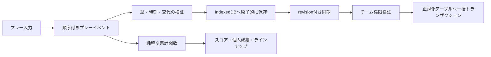
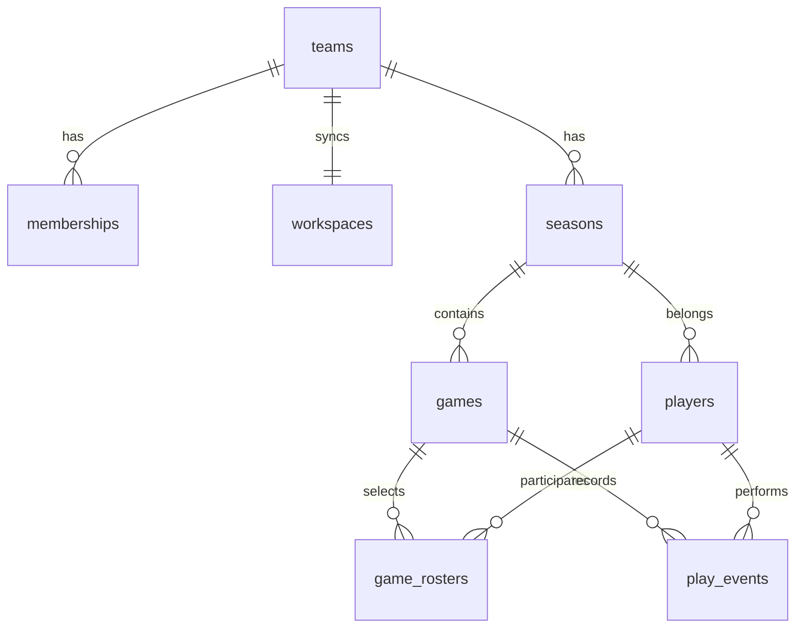

# 設計と開発段階

## 画面と開発計画

1. Phase 1: App Router、レスポンシブな共通UI、型・イベントモデル、SQL。
2. Phase 2: 選手と試合の登録、メール認証、ログインゲート、アカウント別キャッシュ、チームと権限。
3. Phase 3: ライブ入力、時計、イベント由来のスコアと集計。
4. Phase 4: ショット位置、交代、履歴訂正、出場時間、Plus/Minus。
5. Phase 5: 試合・Q・シーズン分析、比較とランキング、戦術観察。
6. Phase 6: PWA、端末保存、競合検出付きクラウド同期、CSVとバックアップ。
7. Phase 7: 計算・DB・ブラウザ検証、公開手順。実Supabase・Vercel接続検証は環境設定後に実施。

各画面は同じWorkspaceと集計関数を使用します。現時点の制約はREADMEに記載しています。

## データの流れ

得点とシュート試投を別々に保存しません。2PMを1件入力するとPTS +2、FGM +1、FGA +1が派生します。Undoや訂正後は元のイベント列から再計算するので、増分カウンターを戻し忘れる問題がありません。

## 出場時間とPlus/Minus

イベントにはQ、試合開始からの経過秒、配列内の順序を保持します。同じ秒の得点と交代も順序を区別します。各区間のコート上5人に出場秒数を加算し、得点イベント時点の5人だけに得失点差を反映します。

延長は規定Qを超えた5分単位です。途中記録の開始時刻は `recordingStart` に保存します。時計を戻す場合は既存イベントの時刻を超えて巻き戻せません。バックアップ読み込み時も全イベントの時刻・交代・参照選手を検査します。

## DB構成

`workspaces.data` は端末が読み込むバージョン付きドキュメントです。正規化した seasons / players / games / game_rosters / play_events は同じSQL関数・同じトランザクションで更新します。途中失敗時は双方ともロールバックします。チーム単位のロックとrevision比較が二重送信・別端末の上書きを防ぎます。sequenceがタイムスタンプの同値を解決します。ショット座標と交代対象はイベントに保持し、重複した計数用テーブルは作りません。

## 権限と保護

- 全テーブルでRLS有効。所属チームのSELECTのみ許可します。
- 通常のINSERT/UPDATE/DELETEはanon・authenticatedに与えません。
- SECURITY DEFINER関数は固定search_path、auth.uid()、チームのroleを確認します。
- create_teamはログイン必須、add_team_memberはadmin必須、save_workspaceはadmin/recorder必須です。
- 閲覧者の書き込みはUIとDBで拒否します。秘密鍵をフロントへ渡しません。
- Reactの文字列エスケープを使用し、HTML文字列は挿入しません。
- CSVは数式注入対策として先頭の =、+、-、@ などを無害化します。
- 実際のメール認証・セッション期限・ドメイン設定はSupabase接続後にも検証してください。

## 今後の拡張

現在は最後に同期したドキュメントを基準に3-way mergeします。異なるイベントの追加・訂正を統合し、同じイベントの矛盾や、別端末が同時刻に入力した交代とプレーの順序が不明な場合は停止します。同じ時刻の既存イベントは各ブランチの順序制約をDAGとして検証します。時計は絶対時刻の期限を使い、単なる残り時間の更新を同期の編集競合として扱いません。

写真はブラウザで256pxのラスター画像に変換し、メタデータを除去します。チームRLSで保護したplayers.photoと同期ドキュメントに格納します。外部画像URLとSVGは受け付けません。大規模化する際はprivate Storage bucketと署名付きURLへ移せます。

さらに大規模な同時記録では、イベント単位のAPI・outbox・サーバーでのマージへ段階的に移行できます。現時点でもイベントIDによる重複防止、revisionによる排他、明示的な競合解決を行います。

AI分析は、検証済みの集計と観察を入力に、非同期の提案を返すサーバー側サービスとして追加します。観測事実・仮説・生成コメントを区別し、API秘密鍵はサーバーだけで管理します。レーダー比較、個人の成績推移、相手の詳細イベント記録、対戦相手別成績は実装済みです。映像時刻のリンク、選手のシーズン間の移籍処理、対戦相手マスターは将来的な独立した拡張対象です。

## クラウド認証と端末データ

Supabase構成ではセッション確認が完了するまで記録画面を表示せず、未ログイン時はメールログインだけを表示します。保存キーは認証ユーザーIDで分離し、別アカウントのキャッシュを読み込みません。ログアウト時も画面をロックします。Next.js設定は公開用キーの種類を検証し、service_roleやsb_secretキーでのビルドを拒否します。実サービスのメール配信・接続確認はプロジェクト作成後の別工程です。

端末のWorkspaceと同期ベースはIndexedDBに保存します。読み取り・比較・書き込みを1つのreadwriteトランザクションにまとめ、同じブラウザの複数タブの競合を原子的に拒否します。自分の書き込みはPromiseキューで順序付けし、端末へのコミット完了後にクラウド同期を開始します。旧localStorageの文書は初回に検証して移行し、コミット成功を確認してから元の値を除去します。アカウント切り替え時は世代番号で古い非同期処理を隔離します。
